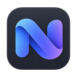

<p align="center">
  
</p>

<h1 align="center">Nexum</h1>

<p align="center">
  macOS 优先的 Rust 下载器，提供原生 Desktop 与 CLI。<br>
  A macOS-first Rust downloader with a native Desktop app and CLI.
</p>

<p align="center">
  <a href="https://github.com/liveait/Nexum/actions/workflows/ci.yml"></a>
  <a href="LICENSE"></a>
</p>

<p align="center">
  <a href="#current-status">当前状态 / Status</a> · <a href="#run-the-local-task-flow">快速开始 / Quick start</a> · <a href="#documentation-and-contribution">文档 / Docs</a>
</p>

<a id="current-status"></a>
<a id="当前状态"></a>
<a id="当前状态--current-status"></a>

## 当前状态 / Status

首个 macOS 版本仍在验收，尚无正式安装包。原生可访问性、全新用户／升级，以及分发签名、公证和安装验收仍待完成。

The first macOS release is still in validation, with no official installer yet. Native accessibility, clean-user/upgrade, distribution signing, notarization and installation acceptance remain open.

- HTTP / HTTPS 单连接下载，支持进度、暂停／恢复和限速。<br>
  Single-connection HTTP / HTTPS downloads with progress, pause/resume and bandwidth limits.
- 任务与进度持久化到 SQLite；中断的部分下载经来源与 Range 校验后跨重启续传，不满足续传条件时从零开始。<br>
  Tasks and progress persist in SQLite. Interrupted partial downloads resume across restarts after source/Range validation, or restart from zero if resume checks fail.
- Desktop 默认管理本地下载服务，也可连接指定服务；CLI 使用独立启动的 Server。<br>
  Desktop manages a local download service by default or connects to a specified service; the CLI uses a separately started Server.

M4 多连接、FTP / FTPS、BT / 磁力下载尚未启用。当前能力与后续验收范围见[开发计划](docs/DEVELOPMENT_PLAN.md)。

M4 multi-connection, FTP / FTPS and BT / magnet downloads remain unavailable. See the [Development Plan](docs/DEVELOPMENT_PLAN.md) for capabilities and remaining acceptance work.

<a id="run-the-local-task-flow"></a>
<a id="运行本地任务流程"></a>
<a id="运行本地任务流程--run-the-local-task-flow"></a>

## 快速开始 / Quick start

需要 Rust stable / Cargo、Node.js（CI 使用 22）、pnpm 11.25.0 及 Tauri 2 平台依赖，详见[环境准备](docs/DEVELOPMENT.md#environment)。以下命令从仓库根目录开始。

Requires Rust stable / Cargo, Node.js (CI uses 22), pnpm 11.25.0 and Tauri 2 platform dependencies; see [Environment](docs/DEVELOPMENT.md#environment). Start these commands at the repository root.

### Desktop

启动原生开发 App；本地模式自动准备和启动随包服务，无需另开 Server。设置也保留远程连接，包括本机独立运行的服务。

Launch the native development app. Local mode prepares and starts its bundled service automatically. Settings also supports remote connections, including a service running separately on this Mac.

```bash
cd apps/desktop
pnpm install --frozen-lockfile
pnpm exec tauri dev
```

### Server 与 CLI / Server and CLI

在仓库根目录的一个终端启动独立 Server：

Start a standalone Server in one terminal at the repository root:

```bash
cargo run --locked -p nexum-server
```

在另一个终端创建、排队并查看下载：

Create, queue and inspect a download from another terminal:

```bash
cargo run --locked -p nexum-cli -- --server 127.0.0.1:39100 task create demo https://example.com/ ./example.html
cargo run --locked -p nexum-cli -- --server 127.0.0.1:39100 task queue demo
cargo run --locked -p nexum-cli -- --server 127.0.0.1:39100 task list
```

独立 Server 默认仅监听 `127.0.0.1:39100`，认证关闭；连接配置见[认证](docs/DEVELOPMENT.md#authentication)与 [TLS](docs/decisions/0005-tls-transport.md)。

The standalone Server defaults to `127.0.0.1:39100` with authentication disabled; see [Authentication](docs/DEVELOPMENT.md#authentication) and [TLS](docs/decisions/0005-tls-transport.md) for connection setup.

<a id="documentation-and-contribution"></a>
<a id="文档与贡献"></a>
<a id="文档与贡献--documentation-and-contribution"></a>

## 文档 / Docs

- [开发指南 / Development Guide](docs/DEVELOPMENT.md)
- [架构设计 / Architecture](docs/ARCHITECTURE.md)
- [Desktop UI 设计 / Desktop UI Design](docs/DESKTOP_UI_DESIGN.md)
- [开发计划 / Development Plan](docs/DEVELOPMENT_PLAN.md)
- [发布流程 / Release Process](docs/RELEASE.md)
- [架构决策 / Architecture Decisions](docs/decisions/README.md)
- [变更日志 / Changelog](CHANGELOG.md)
- [贡献指南 / Contributing](CONTRIBUTING.md)
- [治理规则 / Governance](GOVERNANCE.md)

Nexum 采用 [MIT License](LICENSE)，第三方依赖遵循各自许可证。

Nexum uses the [MIT License](LICENSE); third-party dependencies retain their own licenses.
